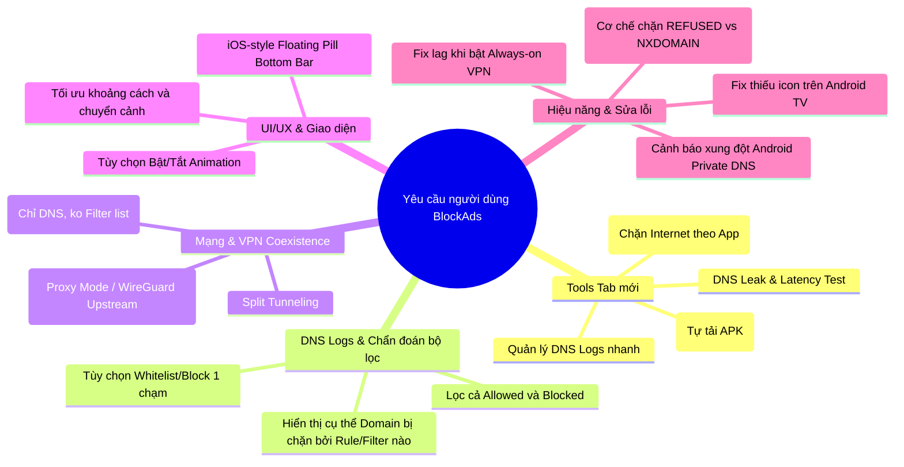

# Kế hoạch phát triển tính năng từ phản hồi cộng đồng (User Feedback Plan)

Tài liệu này tổng hợp, phân loại và đánh giá tính khả thi kỹ thuật cho toàn bộ yêu cầu/ý kiến đóng góp của người dùng trong cộng đồng BlockAds xoay quanh kế hoạch phát triển tab **Tools** và các cải tiến hệ thống.

---

## 1. Tổng quan phân loại phản hồi

---

## 2. Chi tiết các nhóm yêu cầu & Đánh giá kỹ thuật

### Nhóm 1: Tính năng cho tab "Tools" (Công cụ mới)

| Tính năng yêu cầu | Người yêu cầu | Phân tích kỹ thuật & Tính khả thi | Mức độ ưu tiên |
| :--- | :--- | :--- | :---: |
| **DNS Test (Leak & Speed Test)** | *Murtaza Hadi* | Đo ping/RTT tới các upstream DNS (Quad9, Cloudflare, NextDNS...) và kiểm tra rò rỉ DNS (DNS Leak Test). Khả thi cao, triển khai trực tiếp bằng Ktor/DNS query probe. | **Cao (P1)** |
| **In-app Updater (Tự tải & cài APK)** | *Jaf* | Rất hữu ích cho user tải từ GitHub mà không có store tự update. Kiểm tra release mới từ GitHub API, tải APK có thanh tiến trình và gọi PackageInstaller. | **Cao (P1)** |
| **App Firewall (Tường lửa chặn mạng theo app)** | *José Martínez* | Chặn kết nối mạng (Wi-Fi / 4G) của từng ứng dụng được chọn. Go engine `tunnel` đã chặn gói tin theo UID/IP/port, việc chặn toàn bộ traffic của 1 app chỉ cần thêm danh sách UID bị chặn vào IP firewall filter. | **Trung bình (P2)** |
| **Phím tắt / Tích hợp DNS Logs vào Tools** | *『 ⌥ 』 ℤ𝔾𝕏*, *Michael Sharvit* | Đặt lối tắt hoặc module xem nhanh query log ngay trong Tools tab để user dễ dàng gỡ lỗi app bị gián đoạn. | **Cao (P1)** |

---

### Nhóm 2: Cải tiến DNS Query Logs & Chẩn đoán bộ lọc (Troubleshooting)

Người dùng gặp vấn đề lớn: **Bật nhiều filter lists bị lỗi app ngân hàng/giao hàng, không biết domain nào bị chặn hoặc do filter nào chặn.**

1. **Bộ lọc trạng thái trong DNS Logs (Blocked vs Allowed):**
   - *Yêu cầu bởi Ingo S & Michael Sharvit.*
   - Hiện tại: User muốn filter xem các domain **ĐÃ ĐƯỢC CHO PHÉP (Allowed)** để săn lùng các domain quảng cáo/tracker chưa bị chặn, hoặc filter xem **BLOCKED** để tìm domain gây lỗi.
   - **Giải pháp:** Bổ sung Filter Chip trên Logs screen: `[Tất cả]`, `[Đã chặn]`, `[Được phép]`, `[Theo ứng dụng]`.
2. **Rule Attribution (Chỉ rõ domain bị chặn bởi Filter List nào):**
   - *Yêu cầu bởi Sajid N.*
   - Khi domain bị chặn, hiển thị metadata: *Blocked by: Hagezi Pro* thay vì chỉ báo chung chung là đã chặn. Điều này giúp user tắt đúng 1 filter list thay vì phải whitelist cả ứng dụng.

---

### Nhóm 3: Khả năng tương thích VPN & Mạng (VPN Coexistence)

Rất nhiều user (*FIROZ PATEL, K K, JAI, M, Layker84, Sandrito*) phàn nàn: **Android chỉ cho phép 1 VPN chạy cùng lúc**, họ muốn dùng VPN ngoài (Proton VPN, WireGuard) song song với BlockAds.

| Giải pháp | Khả năng triển khai | Đánh giá |
| :--- | :--- | :--- |
| **1. WireGuard Upstream Client** *(Đang có bản beta)* | BlockAds nhận config WireGuard (vd từ Proton, Mullvad), đóng vai trò VPN chính trên Android, lọc quảng cáo trên máy rồi forward traffic mã hóa qua WireGuard tunnel. | **Tốt nhất cho đa số user.** Cần hoàn thiện UI/UX và tính ổn định. |
| **2. Local SOCKS5 / HTTP Proxy Mode** | Chạy Go engine ở chế độ Standalone Proxy (`127.0.0.1:port`) không cần Android VpnService. Thích hợp cho máy Root, hoặc dùng app VPN khác có hỗ trợ chain proxy. | **Cực kỳ hữu ích cho Power Users & Rooted.** |
| **3. BlockAds-Lite (Pure DNS Mode)** | *Yêu cầu bởi Abdullayev*: Chỉ cấu hình Secure DNS (DoH/DoT) cục bộ, không nạp Bloom filter hàng triệu rules. Tiết kiệm RAM và nhẹ máy tối đa. | Rất dễ làm: Thêm profile/preset "Lite Mode" tắt toàn bộ ruleset. |

---

### Nhóm 4: Giao diện (UI/UX) & Tùy chọn hiệu năng

1. **iOS-style Floating Pill Bottom Navigation Bar:**
   - *Yêu cầu bởi iamrymel.*
   - Thiết kế thanh điều hướng dạng viên thuốc (floating pill) nổi trên nền, bo góc mượt, spacing đồng bộ và hoạt ảnh chuyển tab cao cấp.
2. **Tùy chọn tắt Animation (Reduce Motion):**
   - *Yêu cầu bởi Ryandi123.*
   - Bổ sung toggle trong Cài đặt: `Giảm hiệu ứng chuyển động` (`Disable Animations`). Giúp các máy cấu hình thấp mượt mà và tiết kiệm pin hơn.

---

### Nhóm 5: Tối ưu Pin & Sửa lỗi (Bugs & Stability)

| Vấn đề | Chi tiết | Hướng xử lý |
| :--- | :--- | :--- |
| **Icon Android TV bị lỗi** | *TommyCR* báo app icon trên TV chỉ hiện icon robot Android mặc định. | Thiếu thuộc tính `android:banner` và Activity leanback launcher trong `AndroidManifest.xml` của module `blockadstv`. Cần bổ sung banner 16:9 (320x180 dp). |
| **Always-on VPN gây lag filter** | *jang weicheng* báo bật "Always-on VPN" trong Android Settings thì bộ lọc bị giật/lag. | Kiểm tra cơ chế buffer tunnel socket khi hệ thống Android khóa chặt mạng ở tầng kernel trước khi VPN sẵn sàng (`lockdown VPN mode`). |
| **Thông báo lỗi Private DNS** | *Cam* thắc mắc hệ thống báo "Private DNS cannot be accessed". | Khi người dùng bật đồng thời "Private DNS" trong Cài đặt Android và VPN BlockAds, Android cố kết nối DNS TLS qua chính VPN gây loop/fail. Cần thêm Dialog/Card cảnh báo user tắt Private DNS của hệ thống khi bật BlockAds. |
| **Tối ưu pin (Cơ chế REFUSED vs NXDOMAIN)** | *Vikings, Layker84* nhận xét phản hồi `REFUSED` tiết kiệm pin hơn `0.0.0.0` / `NXDOMAIN`. | Mặc định hoặc cho phép tùy chọn kiểu phản hồi chặn DNS: `REFUSED` (RCODE 5), `NXDOMAIN` (RCODE 3), `0.0.0.0`. `REFUSED` khiến app client dừng gửi retry dồn dập, giảm đánh thức CPU. |

---

## 3. Lộ trình triển khai đề xuất (Roadmap)

### Giai đoạn 1: Sửa lỗi tồn đọng & Cải tiến nhanh (Quick Wins)
- [ ] **Android TV Launcher Icon**: Bổ sung `banner` và leanback launcher intent cho Android TV.
- [ ] **DNS Logs Filter**: Thêm chip lọc `Allowed` / `Blocked` trong màn hình Logs.
- [ ] **Private DNS Warning**: Hiển thị cảnh báo hướng dẫn nếu máy đang bật Private DNS gây xung đột.
- [ ] **Toggle Disable Animations**: Tùy chọn tắt hiệu ứng cho máy yếu.

### Giai đoạn 2: Phát triển các công cụ trong "Tools Tab"
- [ ] **DNS Speed & Leak Test**: Công cụ kiểm tra tốc độ phản hồi và rò rỉ DNS.
- [ ] **In-app Updater (GitHub Releases)**: Kiểm tra và tải cập nhật tự động trong app.
- [ ] **BlockAds-Lite Preset**: Chế độ siêu nhẹ chỉ dùng Secure DNS không nạp danh sách lọc.

### Giai đoạn 3: Tường lửa & Tính năng nâng cao
- [ ] **App Firewall**: Giao diện chọn app và chặn truy cập mạng (Wi-Fi/Cellular).
- [ ] **Hoàn thiện WireGuard Upstream & SOCKS5 Proxy Mode**: Cho phép kết hợp với VPN ngoài và các thiết bị Root.
- [ ] **Rule Attribution**: Truy vết chính xác filter list đã chặn domain.
